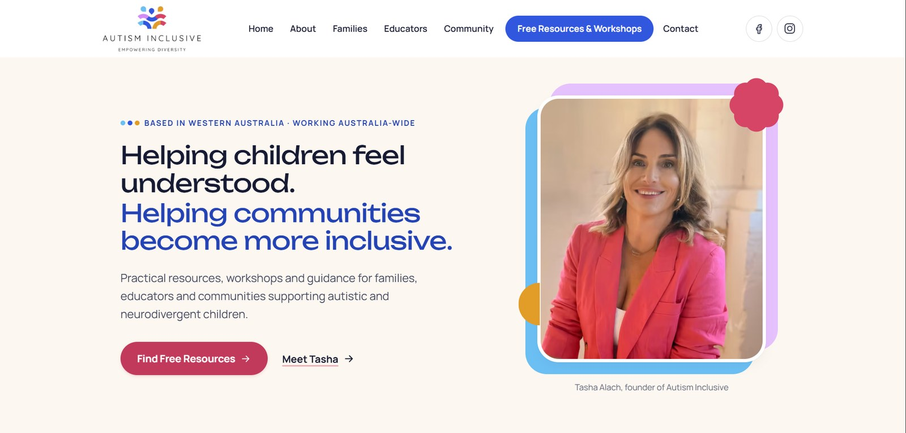
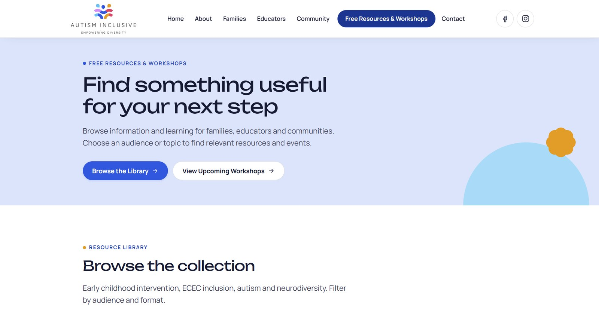
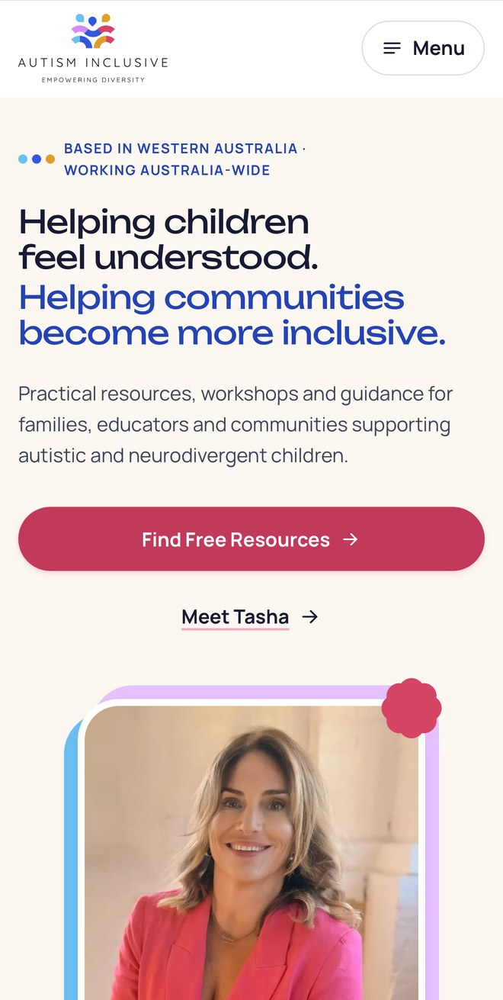
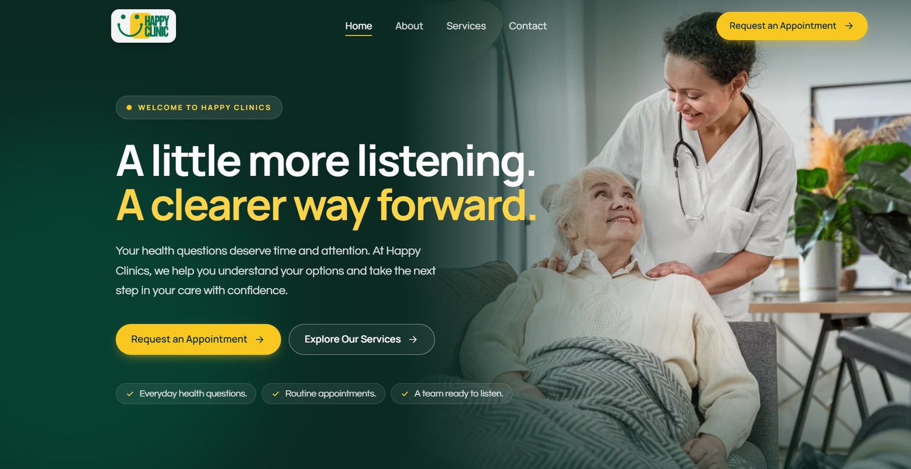
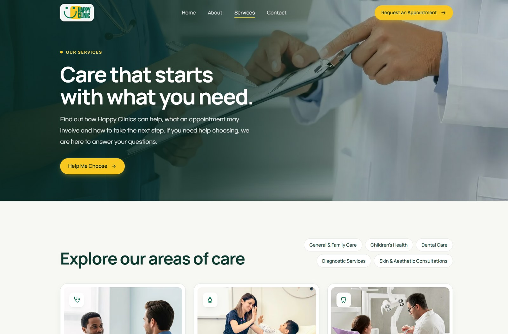
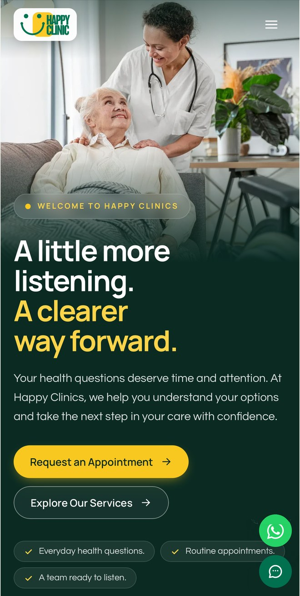
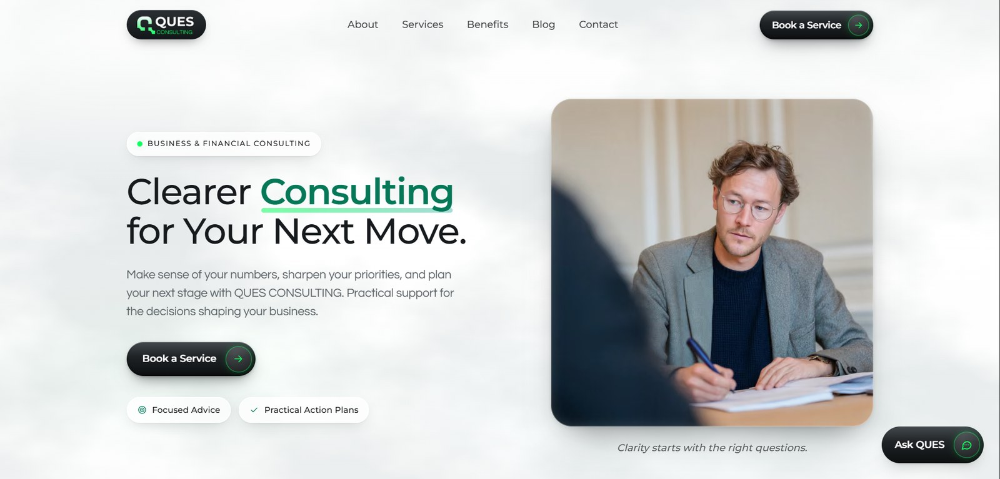
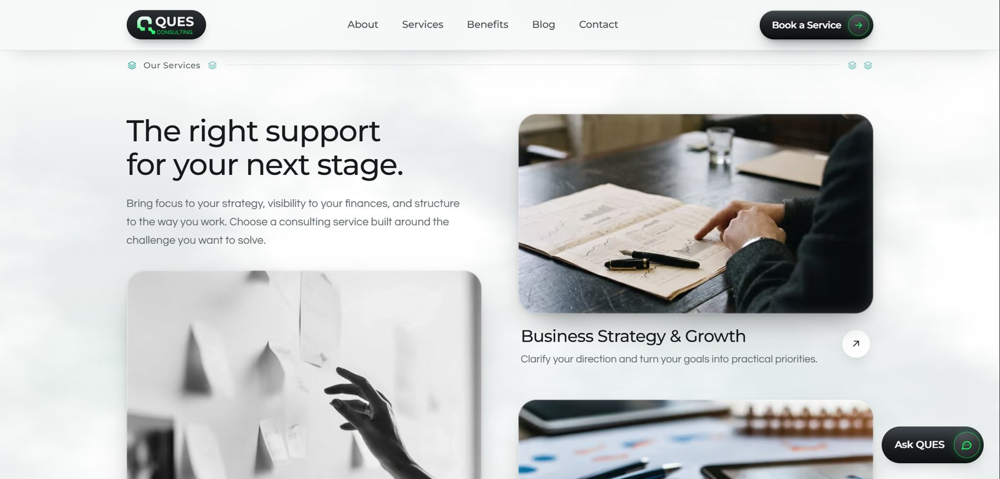
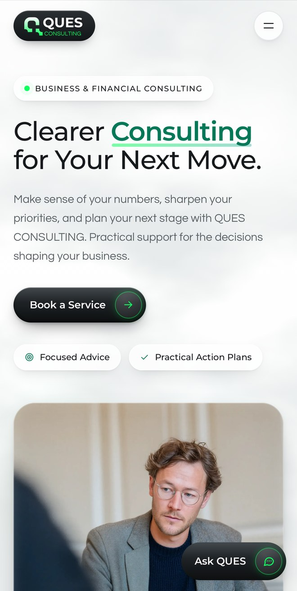

# WALKFLOW

**I help businesses capture leads, automate follow-ups and turn enquiries into sales — through AI automation, n8n, GoHighLevel and web design.**

*Take the steps. Build the flow.*

Get in touch: [walkflow.tech](https://walkflow.tech) · [LinkedIn](https://linkedin.com/in/walkflow)

---

## Lead Capture & Follow-Up Automation

### [AI Lead Generation System](https://github.com/walkflow-portfolio/ai-lead-generation-system)
Finds businesses that need your service, scores every one Hot, Warm or Cold, automates outreach and sends follow-up reminders, all from one dashboard.
`n8n` · `Supabase` · `Telegram` · `Next.js` · `TypeScript`

### [Business Automation Suite](https://github.com/walkflow-portfolio/business-automation-suite)
Captures website enquiries, follows up automatically, prevents double-bookings and alerts you when something fails. Includes a version built for a real-estate agency.
`n8n` · `Gmail` · `Google Calendar` · `Supabase` · `Telegram`

## Automation Tools

### [JobHunt: Automated Opportunity Finder](https://github.com/walkflow-portfolio/job-hunt-automation)
Searches 10+ sources every day, scores every result and sends an instant alert when something worth acting on appears.
`n8n` · `Supabase` · `Telegram` · `Next.js`

## Websites

Custom-built, fast, mobile-friendly websites, designed around what each business needs its visitors to do.

### Autism Inclusive: community education organisation
A website for three very different audiences (families, educators and community), with a searchable resource library and a workshop programme managed from one place.
`Next.js` · `TypeScript` · `Tailwind CSS` · `Supabase`
**[View live site](https://autism-inclusive.vercel.app/)**

  
  
  

### Happy Clinics: multi-service health clinic
A calm, trustworthy clinic website that explains five areas of care and makes it easy to request an appointment, with all text and images managed from one content file.
`Next.js` · `TypeScript` · `Tailwind CSS`
**[View live site](https://happy-clinics.vercel.app/)**

  
  
  

### QUES Consulting: business and financial consulting firm
A site that explains four consulting services clearly, builds trust through a blog, and guides visitors through a booking flow, with an assistant chat widget.
`Next.js` · `TypeScript` · `Tailwind CSS` · `Stripe` · `Claude API`
**[View live site](https://ques-consulting.vercel.app/)**

  
  
  

---

*Want something like this for your business? Get in touch at [walkflow.tech](https://walkflow.tech) or on [LinkedIn](https://linkedin.com/in/walkflow).*
